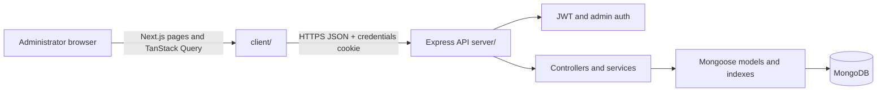

# Doctor Tracker

Doctor Tracker is a healthcare administration workspace for an authorized care-team administrator to manage doctors and patients, keep patient-to-doctor assignments consistent, and review live operational trends. The Next.js application and Express API are separate deployable applications backed by MongoDB.

## Features

- Cookie-based administrator login, logout, session checking, and protected screens/API routes.
- Doctor and patient create, view, edit, delete, search, filter, sort, and server-side pagination.
- Patient assignment to an existing doctor, doctor-specific patient lists, patient counts, and guarded doctor deletion.
- MongoDB-backed dashboard totals, date-based trends, distributions, and recent records.
- Responsive navigation and data views, validation, loading/error/empty states, and confirmation dialogs.
- Fictional, idempotent development seed data. No public administrator registration or appointments API is present.

## Technology

- Frontend: Next.js App Router 16, React 19, JavaScript, Tailwind CSS 4, Lucide React, TanStack Query, React Hook Form, Zod, Recharts.
- Backend: Node.js 20+, Express 5, JavaScript ES modules, MongoDB, Mongoose, Zod, bcryptjs, JWT, Helmet, CORS, express-rate-limit, Pino.
- Verification: Vitest, Testing Library, Playwright, and Node's built-in test runner.

## Prerequisites

- Node.js 20 or newer and npm.
- MongoDB 6 or newer, either a local `mongod` or a MongoDB Atlas deployment.
- Chromium for Playwright end-to-end tests (`cd client; npx playwright install chromium`).

## Local installation

From the repository root, copy the examples and install the two applications:

```powershell
Copy-Item server/.env.example server/.env
Copy-Item client/.env.example client/.env.local
cd server
npm install
cd ../client
npm install
```

Edit `server/.env` before seeding. Use a local-only admin password of at least 12 characters and a unique local JWT secret. The examples contain development placeholders, not deployment credentials.

### MongoDB local setup

Install MongoDB Community Server and start it with a local data folder (from the repository root):

```powershell
New-Item -ItemType Directory -Force server/.data
mongod --dbpath server/.data --bind_ip 127.0.0.1 --port 27017
```

The default `MONGODB_URI` points to `mongodb://127.0.0.1:27017/doctor_tracker`. `server/.data/` is ignored by Git.

### MongoDB Atlas setup

Create an Atlas cluster, a database user with access only to the application database, and a network access rule limited to the backend host's egress IPs. Copy the Atlas connection string into `MONGODB_URI`, including the database name and appropriate URI-encoded credentials. Do not use a broad `0.0.0.0/0` rule for production. Verify the API host can resolve and connect to the cluster before starting the server.

### Environment configuration

`server/.env.example` lists backend settings; `client/.env.example` supplies the frontend API URL. The root `.env.example` is a combined local reference. Copy backend values into `server/.env` and the public API URL into `client/.env.local`.

| Variable | Used by | Purpose |
| --- | --- | --- |
| `PORT` | Server | HTTP listen port (local default `4000`; many hosts inject this). |
| `NODE_ENV` | Server | `development`, `test`, or `production`. |
| `CLIENT_URL` | Server | Comma-separated exact browser origins allowed by CORS, e.g. `http://localhost:3000`. |
| `MONGODB_URI` | Server | MongoDB connection string. |
| `JWT_SECRET` | Server | JWT signing secret; production must provide a unique secret of at least 32 characters. |
| `JWT_EXPIRES_IN` | Server | JWT lifetime accepted by `jsonwebtoken`, e.g. `1d`. |
| `COOKIE_SECURE` | Server | `false` for local HTTP; `true` for HTTPS production. |
| `ADMIN_EMAIL` | Seed/server | Email used by the development seed to create the first admin. |
| `ADMIN_PASSWORD` | Seed/server | Password hashed for the development admin; minimum 12 characters. |
| `NEXT_PUBLIC_API_URL` | Client | Absolute API base URL including `/api/v1`; compiled into the client build. |

Do not commit `.env`, `.env.local`, or real credentials. Production startup rejects default JWT/admin secrets, insecure cookies, and non-HTTPS client origins.

### Development admin and seed data

Set `NODE_ENV=development`, `ADMIN_EMAIL`, `ADMIN_PASSWORD`, and a safe development `MONGODB_URI` in `server/.env`, then run once:

For a fresh local development database, the example defaults are:

- **Email:** `admin@example.test`
- **Password:** `local-only-change-this-password`

These are development-only placeholders. Change `ADMIN_PASSWORD` in `server/.env` before the first seed if you prefer a different password (at least 12 characters). The seed creates the administrator only if that email does not already exist, so changing the environment variable later does not change an existing account's password.

```powershell
cd server
npm run seed
```

The script hashes the administrator password and upserts a small set of fictional doctors and patients. It is idempotent and refuses remote database names unless they explicitly contain `dev`, `development`, or `test`. There is no public admin registration endpoint.

### Start the applications

Use two terminals from the repository root. Start MongoDB first.

Terminal 1:

```powershell
cd server
npm run dev
```

Terminal 2:

```powershell
cd client
npm run dev
```

Open `http://localhost:3000/login`. The API defaults to `http://localhost:4000`; `GET http://localhost:4000/api/v1/health` reports `503` until MongoDB is connected, then `200`. Use the admin account configured before running the seed script.

## API

All routes use the `/api/v1` prefix. Doctor, patient, and dashboard routes require the administrator's HTTP-only session cookie. Login is rate-limited. List endpoints use MongoDB-side search/filter/count/pagination and respond with `{ items, total, pagination: { page, limit, total, totalPages } }`. Create/update/detail responses use `{ data }`; successful deletes return `204`. Errors use `{ error: { code, message, details? } }`.

| Method | Endpoint | Purpose |
| --- | --- | --- |
| GET | `/` | Non-sensitive API name, version, base path, and health path. |
| GET | `/health`, `/api/v1/health` | API and MongoDB readiness; unprotected. |
| POST | `/auth/login` | Verify admin credentials and issue the session cookie. |
| POST | `/auth/logout` | Clear the session cookie. |
| GET | `/auth/me` | Return the current authenticated administrator. |
| GET, POST | `/doctors` | Search/list or create doctors. |
| GET, PATCH, DELETE | `/doctors/:id` | View, update, or delete a doctor. Delete returns `409` while patients remain assigned. |
| GET, POST | `/doctors/:doctorId/patients` | List patients assigned to a doctor, or create one with that doctor preselected. |
| GET, POST | `/patients` | Search/list or create patients. |
| GET, PATCH, DELETE | `/patients/:id` | View, update, or delete a patient. A referenced doctor must exist. |
| GET | `/dashboard/summary` | All-time totals, selected-period counts, and recent records. |
| GET | `/dashboard/trends` | Daily doctor and patient creation totals. |
| GET | `/dashboard/patients-per-doctor` | Patient assignment counts by doctor for the selected period. |
| GET | `/dashboard/distributions` | Doctor specialization and patient condition breakdowns. |
| GET | `/dashboard/activity` | Legacy combined creation trend. |

List queries accept `q`, `page`, `limit` (maximum 100), `sort`, `order`, `createdFrom`, and `createdTo`; resource filters include doctor `specialization` and `hospital`, and patient `doctor`, `condition`, and `gender`. Sort fields are allowlisted. Dashboard queries accept `range=last7`, `last30` (default), `last90`, or `custom` with ordered ISO `from` and `to` values no longer than 366 days.

## Architecture



The frontend is organized around App Router pages, reusable layout/UI components, record hooks, shared forms/tables, validation schemas, and one API utility. The backend separates routes, request validation, controllers, services, models, middleware, config, and scripts. The root `components/` directory is currently empty; active application components live under `client/components/`.

### Request and authentication flow

1. The login form validates locally, then sends credentials to `POST /api/v1/auth/login` with `credentials: "include"`.
2. The backend finds the seeded administrator, verifies `passwordHash` with bcrypt, signs a short-lived issuer/audience-scoped JWT, and sets an HTTP-only cookie scoped to `/api/v1`.
3. Protected pages check `GET /auth/me`; protected API routes validate the cookie JWT and confirm the administrator still exists.
4. An expired or missing session returns `401`; the client clears cached auth state and routes the user to login. JWTs are never stored in web storage.
5. In production the cookie uses `Secure`, `HttpOnly`, `SameSite=None`; local development uses `SameSite=Lax` for localhost HTTP. Production frontend and backend must use HTTPS and `CLIENT_URL` must list the exact frontend origin.

### Technical decisions and trade-offs

**Patient-to-doctor reference, without reverse arrays.** Each patient stores one `doctor` ObjectId reference. Doctor details and list counts are calculated from patients, keeping assignment state authoritative in one place and avoiding synchronization bugs when reassignment/deletion occurs. The trade-off is that counts require indexed lookups/aggregation rather than a constant-time doctor-side array length. Deletion is restricted while patients are assigned.

**HTTP-only cookie session rather than browser-stored JWT.** The browser sends the session cookie automatically but JavaScript cannot read it, reducing token theft from a frontend script injection. Cross-origin production hosting requires HTTPS, `SameSite=None`, exact CORS origins with credentials, and origin checks on write routes. The API stays stateless for JWT verification but still checks the administrator record for revocation through account removal.

## MongoDB indexes and query efficiency

Models declare a unique normalized doctor email and unique normalized administrator email. Doctors also index `(createdAt desc, _id desc)`, `(specialization, createdAt desc)`, `(hospital, createdAt desc)`, and text-search fields. Patients index `(doctor, createdAt desc)`, `(createdAt desc, _id desc)`, `(condition, createdAt desc)`, `(gender, createdAt desc)`, and text-search fields. The patient doctor-reference index supports assignments, doctor counts, and doctor patient lists. `npm run indexes` creates model indexes in environments where automatic production index creation is disabled and removes the redundant single-field creation-date index when its stable compound replacement exists.

List searches, filters, counts, and pagination run in MongoDB with bounded limits, stable `_id` tie-breaking, projections, and lean reads. Dashboard trends and distributions use date-matched aggregation pipelines. Doctor patient-count joins are page-bounded for list views; the dashboard lookup uses the patient doctor/date index. Recent-record queries select display fields and limit results. Dashboard responses use 30-second TanStack Query freshness; record mutations invalidate their resource, related doctor counts, and dashboard query keys. No large-scale benchmark is claimed: recorded `explain("executionStats")` checks used a small seed/test dataset and are not production performance guarantees.

## Actual test and build results

Results from the workspace QA run on 2026-10-21:

- `server: npm test` — 9 passed, 0 failed, including API root/health, database-backed login, authorization, CRUD, validation, duplicate email, missing doctor, date filters, pagination/search, deletion policy, and dashboard aggregation against an isolated `_test` database.
- `client: npm test` — 14 unit tests pass (3 API lifecycle/timeout, 6 auth/session, and 5 records/form/query-state tests). Vitest is scoped to `client/test/`; Playwright specs run separately.
- `client: npm run lint` — passed.
- `client: npm run build` — passed with Next.js 16.4.2 production build.
- `client: npm run test:e2e` — 3 Playwright tests passed: genuine screen capture, doctor/patient create-edit-search-delete including assigned-patient deletion guard, invalid login, and protected navigation.
- Playwright used a local MongoDB 8.2 instance and a dedicated `doctor_tracker_e2e` database with fictional QA records. The backend integration test isolates its URI by appending `_test` or enforcing a `_test` suffix for `MONGODB_TEST_URI`.
- `npm audit` could not contact `registry.npmjs.org` in this environment (`ENOTFOUND`). A prior workspace audit identified 11 client dependency-tree advisories (3 moderate, 6 high, 2 critical), including a high/critical development-tool transitive chain without a compatible fix in the available registry metadata. `npm audit fix --force` was not applied because the suggested change downgraded the Next ESLint config to another major. Re-run audit with registry access before release.

## Visual evidence

These PNG files are genuine screenshots captured from the running production Next.js frontend and local API using Playwright with fictional seeded data:

| Screen | Evidence |
| --- | --- |
| Login | `screenshots/login.png` |
| Dashboard, desktop | `screenshots/dashboard-desktop.png` |
| Dashboard, mobile (390px viewport) | `screenshots/dashboard-mobile.png` |
| Doctors list | `screenshots/doctors.png` |
| Doctor details and assigned patients | `screenshots/doctor-details.png` |
| Patients list | `screenshots/patients.png` |

To recapture, ensure MongoDB is running, configure/seed the isolated Playwright account as described in `client/playwright.config.mjs`, install Chromium with `npx playwright install chromium`, and run `npm run test:e2e` from `client/`. The E2E config launches the API on port 4001, builds and serves the frontend on port 3001, and uses `doctor_tracker_e2e`.

## Deployment readiness

The apps can be deployed independently, but this repository has no provider-specific deployment manifests and has not been publicly deployed.

1. Create a MongoDB Atlas database and a least-privilege database user; restrict network access to the backend host.
2. Deploy `server/` as a Node.js service with `npm install` at build/install and `npm start` at runtime. Set `NODE_ENV=production`, the provider `PORT`, Atlas `MONGODB_URI`, a unique `JWT_SECRET`, `JWT_EXPIRES_IN`, `COOKIE_SECURE=true`, strong `ADMIN_EMAIL`/`ADMIN_PASSWORD`, and `CLIENT_URL=https://<frontend-domain>`. For two separately hosted applications, configure both HTTPS origins only when needed.
3. Run the protected deployment migration/index command `npm run indexes` against the target database as an explicit release step. Provision the first administrator through a controlled secure process; the built-in seed is development-only and refuses production.
4. Deploy `client/` to a Node-capable Next.js host (for example, Vercel) with `NEXT_PUBLIC_API_URL=https://<api-domain>/api/v1` set at build time. Build with `npm run build`; serve with the platform's Next.js integration or `npm start`.
5. Ensure both origins use HTTPS. Cookie-based cross-origin sessions require production `SameSite=None; Secure; HttpOnly`, `credentials: true`, exact backend `CLIENT_URL` allowlisting, and matching frontend API URL. Verify browser preflight, login, `/auth/me`, logout, and API health on the deployed origins.

No credentials should be placed in source control or build logs. The health endpoint reports database connectivity but does not implement a separate liveness/readiness protocol.

## Limitations and next steps

- No appointments, scheduling, roles beyond a single admin, audit history, or password reset flow.
- No production administrator provisioning workflow; seed is intentionally development-only.
- Cross-origin cookie deployment needs browser verification on the selected hosting domains and browser privacy settings.
- Client dependency audit needs to be rerun when registry/network access is available and upgraded through compatible versions.
- The small local dataset is sufficient for behavior checks but not for production capacity planning; collect explain plans and representative load measurements before tuning indexes further.
- Add a deployment health/liveness strategy, structured audit events, and backup/restore procedures before handling real patient data.

## Repository structure

```text
doctor_tracker/
├── README.md
├── .env.example
├── screenshots/                 # Captured browser evidence
├── client/
│   ├── app/                     # App Router pages/layouts
│   ├── components/              # auth, layout, shared UI
│   ├── hooks/                   # TanStack Query data hooks
│   ├── lib/                     # API client, query client, schemas
│   ├── test/                    # Vitest and Testing Library
│   ├── e2e/                     # Playwright browser scenarios
│   ├── package.json
│   └── playwright.config.mjs
└── server/
    ├── src/
    │   ├── config/              # Environment and database connection
    │   ├── models/              # Admin, Doctor, Patient
    │   ├── routes/              # Versioned REST route definitions
    │   ├── controllers/         # HTTP adapters
    │   ├── services/            # CRUD and analytics operations
    │   ├── middleware/          # Auth, CORS, validation, errors
    │   ├── validators/          # Zod request schemas
    │   ├── utils/               # Logging and shared errors
    │   ├── scripts/             # Seed and index setup
    │   ├── app.js
    │   └── index.js
    ├── test/                    # Node tests and isolated DB integration
    └── package.json
```
